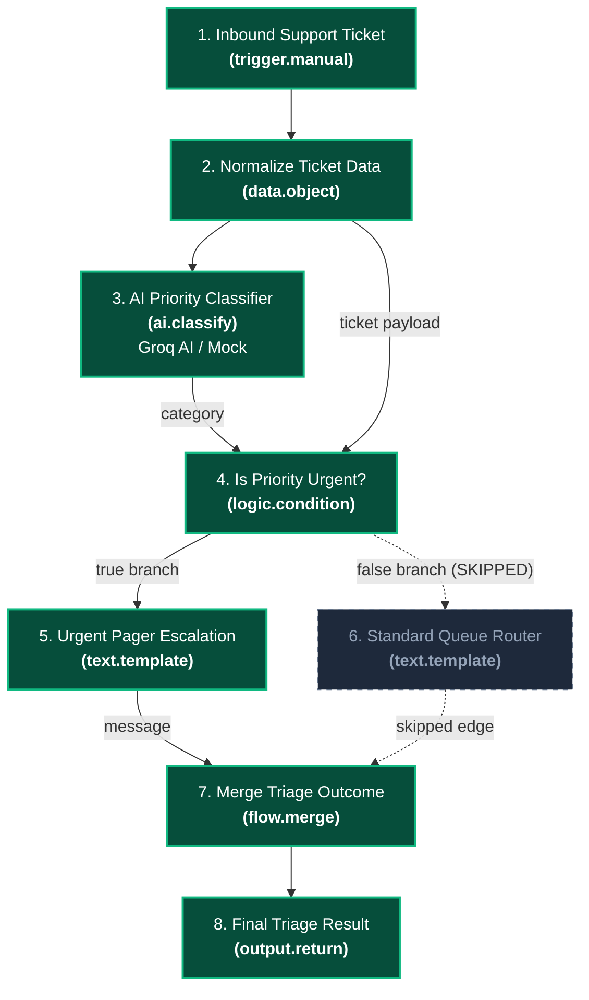

# Dormammu Engine: Complete System Architecture & Codebase Reference

## 📋 Executive Overview

**Dormammu Engine (Webster Workflow Automation)** is a production-grade, visual DAG (Directed Acyclic Graph) workflow automation engine designed for deterministic data pipelines, intelligent control-flow branching, and AI orchestration.

Built with a modular Node.js/Express backend, Neon PostgreSQL persistence (via Prisma), and a high-performance React canvas interface, Dormammu Engine bridges the gap between simple linear job execution and advanced visual automation.

### Core Architectural Guarantees
1. **Deterministic Execution**: Given the same workflow definition and input payload, graph execution follows predictable topological ordering with strict tie-breaking.
2. **Branch-Aware Control Flow**: Branching nodes (`logic.condition`, `logic.switch`) activate only selected output ports. Unselected paths cascade `SKIPPED` statuses downstream without triggering node handlers or causing workflow deadlocks.
3. **Transparent AI Capabilities**: Native provider integration is built exclusively for **Groq AI** (`llama-3.3-70b-versatile`, `llama-3.1-8b-instant`), alongside deterministic offline simulation mode (`[DEMO MOCK]`). Live execution is visibly distinguished from mock execution in both API responses and UI badges.
4. **Hardened Security Model**: Outbound network requests enforce strict Server-Side Request Forgery (SSRF) protections against private CIDRs and cloud metadata services, hop-by-hop redirect verification, streaming payload limits, secret token masking, and zero arbitrary JavaScript code evaluation.

---

## 🗂️ Complete Directory & Folder Structure Walkthrough

```
Dormammu-Engine/
├── backend/                             # Core Node.js / Express backend service
│   ├── prisma/                          # Prisma ORM schema and database migrations
│   │   ├── migrations/                  # Historical PostgreSQL migration scripts
│   │   └── schema.prisma                # Canonical PostgreSQL database schema
│   ├── src/                             # Backend application source code
│   │   ├── config/                      # Environment and database configuration
│   │   ├── controllers/                 # Express request handlers
│   │   ├── engine/                      # Webster Workflow & DAG Execution Engine
│   │   │   ├── contracts/               # Core data structures, ports, errors, context
│   │   │   ├── planner/                 # Execution graph planner and topological sorter
│   │   │   ├── providers/               # Sole AI Provider integration (Groq AI LPU & Mock)
│   │   │   ├── registry/                # 32 Canonical Node definitions and handlers
│   │   │   │   └── nodes/               # Modular node definition files
│   │   │   ├── runtime/                 # Individual node input/output resolution & execution
│   │   │   ├── scheduler/               # Sequential DAG execution engine with branch pruning
│   │   │   ├── utils/                   # Engine security utilities (SSRF validator)
│   │   │   └── validator/               # Graph structure, cycle detection, and port validator
│   │   ├── middleware/                  # Authentication, JWT, and session middleware
│   │   ├── routes/                      # REST API route endpoints
│   │   ├── services/                    # Business logic and database persistence services
│   │   ├── types/                       # TypeScript declaration files for backend models
│   │   └── utils/                       # Shared token generators, user agent parsers, validators
│   ├── workflows/                       # Preconfigured canonical workflow templates
│   │   └── ai_support_triage_workflow.json # Premier AI Support Triage showcase workflow
│   ├── server.js                        # Backend entrypoint and Express server bootstrap
│   ├── test_workflow_engine.js          # Unit & integration test suite (55 tests)
│   └── test_api_and_integration.js      # PostgreSQL persistence & API integration suite (10 tests)
│
├── frontend/                            # React 18 / Vite visual editor frontend
│   ├── public/                          # Static public web assets
│   ├── src/                             # Frontend client application source code
│   │   ├── assets/                      # Icons, SVG vectors, and hero graphics
│   │   ├── components/                  # UI components (Navbar, Hero, Modals, Profiles)
│   │   │   └── workflow/                # Visual workflow canvas editor & execution components
│   │   │       ├── autoLayout.js        # Automatic DAG node positioning engine
│   │   │       ├── EdgePath.jsx         # SVG bezier connection wires with status glow
│   │   │       ├── NodeCard.jsx         # Interactive canvas node with colored port handles
│   │   │       ├── NodeInspector.jsx    # Real-time node configuration property drawer
│   │   │       ├── NodePalette.jsx      # Categorized draggable/clickable node library
│   │   │       ├── QuickAddPopover.jsx  # Rapid port-compatible connection popover
│   │   │       ├── RunExecutionModal.jsx# Workflow execution modal, sample scenarios & live trace
│   │   │       ├── ValidationDrawer.jsx # Visual error and cycle detection drawer
│   │   │       ├── WorkflowEditor.jsx   # Infinite canvas, panning, zooming, and wire routing
│   │   │       └── WorkflowList.jsx     # Workflow management dashboard & starter templates
│   │   ├── context/                     # Global state (ThemeContext dark/light mode)
│   │   ├── services/                    # API client with token auto-refresh (`api.js`)
│   │   ├── types/                       # TypeScript definitions for visual canvas nodes
│   │   ├── App.css                      # Application component styles
│   │   ├── App.jsx                      # Main React routing and view container
│   │   ├── index.css                    # Design system, CSS variables, glassmorphism utilities
│   │   └── main.jsx                     # Vite React application entrypoint
│   └── vite.config.js                   # Vite bundler configuration and reverse proxy
│
└── docs/                                # Technical documentation and guides
    ├── NODE_REFERENCE_AND_WORKFLOW_GUIDE.md # 32-Node catalogue and user workflow guide
    └── FULL_ARCHITECTURE_AND_CODEBASE_REFERENCE.md # This comprehensive master reference
```

---

## 📄 File-by-File Technical Directory

### 1. Backend Core & Engine (`backend/src/engine/`)

#### Contracts & Core Interfaces (`backend/src/engine/contracts/`)
- **[ports.js](file:///Users/aayanshniranjan/Projects/Dormammu-Engine/backend/src/engine/contracts/ports.js)**: Defines the port typing system (`PortTypes.STRING`, `NUMBER`, `BOOLEAN`, `OBJECT`, `ARRAY`, `ANY`). Implements `defineInputPort()` and `defineOutputPort()` factories enforcing name, type, required status, and `allowMultiple` flags for multi-edge inputs.
- **[errors.js](file:///Users/aayanshniranjan/Projects/Dormammu-Engine/backend/src/engine/contracts/errors.js)**: Central repository of structured error codes (`ErrorCodes`) and the `EngineError` class. Encapsulates error code, human-readable message, node context, and error timestamps.
- **[context.js](file:///Users/aayanshniranjan/Projects/Dormammu-Engine/backend/src/engine/contracts/context.js)**: Defines the runtime execution context passed to node handlers, providing run metadata, `abortSignal` listeners, logger delegates, and state getters.

#### Execution Planning & Validation (`backend/src/engine/planner/` & `validator/`)
- **[workflow.validator.js](file:///Users/aayanshniranjan/Projects/Dormammu-Engine/backend/src/engine/validator/workflow.validator.js)**: Validates workflow graph structure prior to execution.
  - Detects self-loops (`A -> A`) and multi-node cycles (`A -> B -> C -> A`) using depth-first search.
  - Ensures source and target nodes exist in the definition.
  - Verifies port existence on static and dynamic nodes (e.g. `logic.switch` dynamic cases).
  - Enforces single-incoming-edge rules on ports unless `allowMultiple: true` is explicitly declared (as in `flow.merge`).
  - Validates node-specific configuration schemas via `validateConfig()`.
- **[execution.planner.js](file:///Users/aayanshniranjan/Projects/Dormammu-Engine/backend/src/engine/planner/execution.planner.js)**: Transforms a validated workflow graph into an executable execution plan.
  - Computes in-degree dependency counts for each node.
  - Maps incoming and outgoing edges per node for instant lookup.
  - Identifies root trigger nodes (`inDegree === 0`).
  - Performs a topological sort validation check.

#### AI Provider Abstraction (`backend/src/engine/providers/`)
- **[ai.provider.js](file:///Users/aayanshniranjan/Projects/Dormammu-Engine/backend/src/engine/providers/ai.provider.js)**: Sole AI provider dispatcher exclusively integrating **Groq AI** (`https://api.groq.com/openai/v1/chat/completions`).
  - `callGroq(apiKey, prompt, systemInstruction, abortSignal, model)`: Communicates with Groq OpenAI-compatible REST API using high-performance models (`llama-3.3-70b-versatile` default, `llama-3.1-8b-instant`).
  - `callMockAi(taskType, payload)`: Deterministic, keyword-aware simulation fallback when running offline tests without external API credentials.
  - `executeAiTask(taskType, payload, options)`: Dispatches tasks exclusively to Groq AI. Enforces timeouts (20,000ms), structured JSON response parsing, and strict error re-throwing.

#### Runtime & Scheduler (`backend/src/engine/runtime/` & `scheduler/`)
- **[node.runtime.js](file:///Users/aayanshniranjan/Projects/Dormammu-Engine/backend/src/engine/runtime/node.runtime.js)**: Executes a single node within the engine.
  - Resolves input values from upstream task execution records.
  - Groups values into arrays for multi-wire ports (`allowMultiple: true`).
  - Validates input and output port schemas against `PortTypes`.
  - Preserves internal metadata keys prefixed with `_` (e.g. `_aiExecution`).
  - Measures execution duration in milliseconds.
- **[dag.scheduler.js](file:///Users/aayanshniranjan/Projects/Dormammu-Engine/backend/src/engine/scheduler/dag.scheduler.js)**: The sequential DAG scheduler that coordinates graph traversal and control flow.
  - Tracks individual edge states (`PENDING`, `ACTIVE`, `SKIPPED`).
  - Compares emitted output ports against wire connections to mark active vs inactive branches.
  - Implements `skipNode()`: recursively cascades `SKIPPED` status down inactive branches.
  - Implements `evaluateTargetReadiness()`: evaluates whether a node is ready to execute or should be skipped.
  - Special handling for `flow.merge`: waits until all incoming branches are resolved; executes if at least one branch is active; skips only if all branches were skipped.
  - Reconciles overall workflow completion to `SUCCEEDED` when skipped paths terminate cleanly.
  - Enforces fail-fast `BLOCKED` propagation on node failure and `CANCELLED` propagation on `AbortSignal`.

#### Security Utilities (`backend/src/engine/utils/`)
- **[ssrf.validator.js](file:///Users/aayanshniranjan/Projects/Dormammu-Engine/backend/src/engine/utils/ssrf.validator.js)**: Outbound network request security validator.
  - Protocol Whitelist: strictly permits `http:` and `https:`.
  - IPv4 Subnet Check: blocks loopback (`127.0.0.0/8`), private subnets (`10.0.0.0/8`, `172.16.0.0/12`, `192.168.0.0/16`), cloud metadata (`169.254.0.0/16`), CGNAT (`100.64.0.0/10`), multicast (`224.0.0.0/4`), and broadcast (`255.255.255.255/32`).
  - IPv6 Subnet Check: blocks `::1`, `::`, unique local (`fc00::/7`), link-local (`fe80::/10`), and IPv4-mapped IPv6 addresses (`::ffff:127.0.0.1`).
  - DNS Resolution Verification: performs hostname lookups via `dns.promises.lookup` and checks every resolved IP record to defeat DNS rebinding attacks.

#### Node Registry (`backend/src/engine/registry/`)
- **[node.registry.js](file:///Users/aayanshniranjan/Projects/Dormammu-Engine/backend/src/engine/registry/node.registry.js)**: In-memory registry storing canonical node definitions. Preserves static definitions, dynamic output generators (`getDynamicOutputs`), dynamic input generators (`getDynamicInputs`), and provides lookup by type.
- **[nodes/index.js](file:///Users/aayanshniranjan/Projects/Dormammu-Engine/backend/src/engine/registry/nodes/index.js)**: Master registration file that imports and registers all 32 canonical node definitions into the default registry.

---

### 2. Backend Services, Routes & Persistence

- **[server.js](file:///Users/aayanshniranjan/Projects/Dormammu-Engine/backend/server.js)**: Express HTTP application bootstrap. Configures CORS, JSON body parsers, seeds PostgreSQL node definitions on startup, mounts API routes, and binds to `PORT` (5001).
- **[prisma/schema.prisma](file:///Users/aayanshniranjan/Projects/Dormammu-Engine/backend/prisma/schema.prisma)**: Canonical database schema defining PostgreSQL models:
  - `User`: Accounts, hashed credentials, avatar URLs, and verification state.
  - `Session`: Active refresh tokens, IP addresses, user agents, and revocation status.
  - `Workflow`: High-level workflow entity referencing user owner.
  - `WorkflowVersion`: Immutable versioned workflow graphs (`nodes`, `edges`, `samplePayload`).
  - `WorkflowRun`: Execution history, overall status (`SUCCEEDED`, `FAILED`, `CANCELLED`), duration, and trigger payload.
  - `TaskRun`: Granular node execution snapshots (`status`, `inputs`, `outputs`, `durationMs`, `error`).
  - `NodeDefinition`: Database metadata catalogue of registered nodes and schemas.
- **[src/services/workflow.service.js](file:///Users/aayanshniranjan/Projects/Dormammu-Engine/backend/src/services/workflow.service.js)**: Manages workflow CRUD, immutable version creation (`createWorkflowVersion`), workflow execution triggers, and authorization checks.
- **[src/services/node.service.js](file:///Users/aayanshniranjan/Projects/Dormammu-Engine/backend/src/services/node.service.js)**: Idempotent node definition seeder (`seedNodeDefinitions`) that upserts registry nodes into the PostgreSQL database.
- **[src/routes/workflow.routes.js](file:///Users/aayanshniranjan/Projects/Dormammu-Engine/backend/src/routes/workflow.routes.js)**: REST endpoints for listing, creating, retrieving, validating, and executing workflows.
- **[src/routes/node.routes.js](file:///Users/aayanshniranjan/Projects/Dormammu-Engine/backend/src/routes/node.routes.js)**: REST endpoints for retrieving the node catalogue and node schemas.

---

### 3. Frontend Architecture (`frontend/src/`)

- **[WorkflowEditor.jsx](file:///Users/aayanshniranjan/Projects/Dormammu-Engine/frontend/src/components/workflow/WorkflowEditor.jsx)**: Main visual canvas workspace.
  - Manages infinite canvas zooming, panning, and grid backgrounds.
  - Coordinates node selection, dragging, keyboard shortcuts (Delete, Undo, Save).
  - Handles wire dragging and connection establishment between ports.
  - Synchronizes with backend validation endpoints.
- **[NodeCard.jsx](file:///Users/aayanshniranjan/Projects/Dormammu-Engine/frontend/src/components/workflow/NodeCard.jsx)**: Interactive SVG/HTML node card component.
  - Renders category icon, label, node ID, and status badge (`SUCCEEDED`, `FAILED`, `SKIPPED`, `CANCELLED`).
  - Dynamically renders input and output port handles.
  - Color-codes control-flow ports: `#10b981` (emerald) for `true`, `#f43f5e` (rose) for `false`, and `#a78bfa` (purple) for `default`.
  - Supports dynamic case output ports for `logic.switch`.
  - Dims opacity and applies dashed borders for skipped nodes.
- **[NodePalette.jsx](file:///Users/aayanshniranjan/Projects/Dormammu-Engine/frontend/src/components/workflow/NodePalette.jsx)**: Left sidebar node catalogue.
  - Categorizes nodes: `Triggers`, `Logic`, `Flow`, `Data`, `Math`, `Text`, `HTTP`, `AI`, `Utility`, `Output`.
  - Supports search filtering and 1-click addition to canvas.
- **[NodeInspector.jsx](file:///Users/aayanshniranjan/Projects/Dormammu-Engine/frontend/src/components/workflow/NodeInspector.jsx)**: Right sidebar property inspector.
  - Auto-generates configuration forms based on the node's `configSchema`.
  - Generates `<select>` dropdowns for enum fields (operators, merge modes, AI providers).
  - Provides JSON textareas for structured array and object schemas.
- **[RunExecutionModal.jsx](file:///Users/aayanshniranjan/Projects/Dormammu-Engine/frontend/src/components/workflow/RunExecutionModal.jsx)**: Interactive execution modal.
  - Provides 1-click test scenarios: **`📋 Scenario 1: Normal Billing`** and **`🚨 Scenario 2: Critical Outage`**.
  - Displays real-time task execution sequence with status badges.
  - Renders transparent AI execution badges: `⚡ Live AI (grok)`, `⚡ Live AI (gemini)`, `⚡ Live AI (openai)`, or `🎭 Demo Simulation`.
  - Displays formatted final workflow output JSON with 1-click clipboard copying.
- **[EdgePath.jsx](file:///Users/aayanshniranjan/Projects/Dormammu-Engine/frontend/src/components/workflow/EdgePath.jsx)**: SVG cubic bezier wire renderer calculating port positions and rendering connecting wires with glow states.
- **[ValidationDrawer.jsx](file:///Users/aayanshniranjan/Projects/Dormammu-Engine/frontend/src/components/workflow/ValidationDrawer.jsx)**: Bottom drawer displaying graph validation warnings, errors, and cycle detection traces.
- **[WorkflowList.jsx](file:///Users/aayanshniranjan/Projects/Dormammu-Engine/frontend/src/components/workflow/WorkflowList.jsx)**: Dashboard view displaying saved workflows, run stats, and featured starter templates (including the AI Support-Ticket Triage template).

---

## 🧩 Complete 32-Node Technical Specification

### Category 1: Logic & Branching

#### `logic.condition`
- **Identifier**: `logic.condition` | **Version**: 1 | **Category**: `logic`
- **Label**: `Condition (If/Else)`
- **Description**: Evaluates input `a` against input `b` (or configured value) using a comparison operator. Emits output along port `true` or `false`.
- **Inputs**:
  - `a` (`any`, required): Primary value for comparison.
  - `b` (`any`, optional): Secondary value (overrides config if provided).
  - `data` (`any`, optional): Passthrough payload forwarded to the active branch.
- **Outputs**:
  - `true` (`any`): Emitted when condition evaluates to true.
  - `false` (`any`): Emitted when condition evaluates to false.
  - `output` (`boolean`): Boolean result of the evaluation.
- **Configuration Schema**:
  - `operator` (`string`, default: `===`, enum: `===`, `!==`, `<`, `<=`, `>`, `>=`, `truthy`, `falsy`, `empty`, `not_empty`, `contains`, `starts_with`, `ends_with`, `regex`, `is_null`).
  - `value` (`any`, optional): Comparison reference value.
- **Execution Semantics**: The inactive port is omitted from outputs. Downstream edges attached to the omitted port become `SKIPPED`.

#### `logic.switch`
- **Identifier**: `logic.switch` | **Version**: 1 | **Category**: `logic`
- **Label**: `Switch (Case Routing)`
- **Description**: Evaluates input value against configured cases and routes data through the matching case output port.
- **Inputs**:
  - `value` (`any`, required): Value to evaluate against cases.
  - `data` (`any`, optional): Optional data payload passed to the matching branch.
- **Outputs**:
  - Dynamic case output ports generated per case key (e.g. `urgent`, `bug`, `billing`).
  - `default` (`any`): Emitted when no configured cases match.
  - `output` (`any`): Passthrough data value.
- **Configuration Schema**:
  - `cases` (`array` of strings/objects, required): List of case identifiers.
  - `strict` (`boolean`, default: `true`): Enforces strict type equality.

---

### Category 2: Flow Control

#### `flow.merge`
- **Identifier**: `flow.merge` | **Version**: 1 | **Category**: `flow`
- **Label**: `Merge Branches`
- **Description**: Combines data and execution from multiple upstream branches into a single unified path.
- **Inputs**:
  - `input` (`any`, `allowMultiple: true`): Multiple incoming branch connections.
  - `a` (`any`, optional): Alternative branch A input.
  - `b` (`any`, optional): Alternative branch B input.
- **Outputs**:
  - `output` (`any`): The merged result value.
- **Configuration Schema**:
  - `mode` (`string`, default: `first_available`, enum: `first_available`, `coalesce`, `all`, `object`):
    - `first_available`: Forwards the first available active branch value.
    - `coalesce`: Forwards the first non-null, non-undefined active value.
    - `all`: Collects values from all active branches into an array `[val1, val2, ...]`.
    - `object`: Merges objects from all active branches into `{ ...obj1, ...obj2 }`.
- **Execution Semantics**: Waits until every incoming branch edge is resolved. Executes if at least one incoming branch is active; skips only if all branches were skipped.

#### `flow.delay`
- **Identifier**: `flow.delay` | **Version**: 1 | **Category**: `flow`
- **Label**: `Delay`
- **Description**: Non-blocking delay pausing execution for a configured duration without blocking the Node.js event loop.
- **Inputs**:
  - `input` (`any`, optional): Passthrough payload.
- **Outputs**:
  - `output` (`any`): Passthrough payload released after delay.
  - `delayedMs` (`number`): Actual elapsed delay in milliseconds.
- **Configuration Schema**:
  - `durationMs` (`number`, default: `1000`, min: `0`, max: `300000`): Delay duration in ms. Supports cancellation via `AbortSignal`.

---

### Category 3: Data Transformation

#### `data.object`
- **Identifier**: `data.object` | **Version**: 1 | **Category**: `data`
- **Label**: `Construct Object`
- **Description**: Constructs structured, nested objects from static values and incoming port data.
- **Inputs**:
  - `input` (`any`, optional): Dynamic object input mapping.
- **Outputs**:
  - `output` (`object`): Constructed JSON object.
- **Configuration Schema**:
  - `fields` (`array` of `{ key, value, fromInput }`): Field configuration.
- **Security**: Preserves falsy values (`0`, `false`, `""`, `null`) and protects against prototype pollution (`__proto__`, `constructor`, `prototype`).

#### `data.array.map`
- **Identifier**: `data.array.map` | **Version**: 1 | **Category**: `data`
- **Label**: `Array Map`
- **Description**: Performs pure, declarative transformations across array items without executing arbitrary JavaScript.
- **Inputs**:
  - `array` (`array`, required): Input array to transform.
- **Outputs**:
  - `output` (`array`): Transformed output array.
- **Configuration Schema**:
  - `operation` (`string`, enum: `pluck`, `uppercase`, `lowercase`, `trim`, `math_multiply`, `math_add`, `wrap_object`, `filter_truthy`).
  - `field` (`string`, optional): Property name for extraction or object wrapping.
  - `operand` (`number`, optional): Mathematical operand.
- **Limits**: Enforces array size limits (max 5,000 items).

#### `data.input`
- **Identifier**: `data.input` | **Version**: 1 | **Category**: `data`
- **Label**: `Extract Input`
- **Description**: Extracts a top-level property from workflow trigger data.
- **Outputs**:
  - `output` (`any`): Extracted property value.
- **Configuration Schema**:
  - `key` (`string`): Property key to extract.
  - `defaultValue` (`any`, optional): Fallback value.

---

### Category 4: Text Processing

#### `text.template`
- **Identifier**: `text.template` | **Version**: 1 | **Category**: `text`
- **Label**: `Text Template`
- **Description**: Renders text templates using safe Mustache-style `{{variable}}` interpolation with dot notation (`{{user.name}}`).
- **Inputs**:
  - `input` (`any`, optional): Object containing template variables.
- **Outputs**:
  - `output` (`string`): Rendered string.
- **Configuration Schema**:
  - `template` (`string`): Template text.
  - `missingVariablePolicy` (`string`, default: `empty`, enum: `empty`, `preserve`, `error`).
  - `escapeHtml` (`boolean`, default: `false`): HTML entity escaping.

#### `text.concat`
- **Identifier**: `text.concat` | **Version**: 1 | **Category**: `text`
- **Label**: `Concatenate Text`
- **Description**: Combines string inputs with custom separators and suffixes.
- **Inputs**:
  - `a` (`string`), `b` (`string`).
- **Outputs**:
  - `output` (`string`): Combined string.

---

### Category 5: HTTP & Webhooks

#### `http.request`
- **Identifier**: `http.request` | **Version**: 1 | **Category**: `http`
- **Label**: `HTTP Request`
- **Description**: Dispatches outbound HTTP requests with strict SSRF protection, timeout enforcement, secret resolution, and streaming size limits.
- **Inputs**:
  - `body` (`any`, optional): Request body payload.
  - `url` (`string`, optional): Target URL destination.
  - `headers` (`object`, optional): Request headers map.
- **Outputs**:
  - `output` (`any`): Parsed response body (JSON object or string).
  - `status` (`number`): HTTP status code.
  - `headers` (`object`): Response headers map.
- **Configuration Schema**:
  - `url` (`string`): Target URL.
  - `method` (`string`, default: `GET`, enum: `GET`, `POST`, `PUT`, `PATCH`, `DELETE`, `HEAD`).
  - `headers` (`object`, default: `{}`): Headers supporting `{{secrets.VAR}}` tokens.
  - `timeoutMs` (`number`, default: `10000`, max: `30000`): Request timeout.
  - `allowPrivateNetwork` (`boolean`, default: `false`): Requires server environment policy `ALLOW_PRIVATE_NETWORK_REQUESTS=true`.
- **Security Guards**:
  - Protocol whitelist (`http:`, `https:`).
  - Private CIDR blocklist (`127.0.0.0/8`, `10.0.0.0/8`, `172.16.0.0/12`, `192.168.0.0/16`, `169.254.0.0/16`, `::1`).
  - Manual redirect tracking with SSRF re-check on every hop (max 5 hops).
  - Streaming size cap: 2MB limit enforced incrementally during chunk download.

#### `http.respond`
- **Identifier**: `http.respond` | **Version**: 1 | **Category**: `http`
- **Label**: `HTTP Respond`
- **Description**: Delivers HTTP responses for inbound webhook and API-triggered executions. Gracefully records simulated delivery in manual/test contexts.
- **Inputs**:
  - `body` (`any`, optional): Payload to return.
  - `status` (`number`, optional): HTTP status code.
- **Outputs**:
  - `output` (`object`): Response delivery receipt (`delivered`, `simulated`, `statusCode`, `body`).

---

### Category 6: Artificial Intelligence

#### `ai.classify`
- **Identifier**: `ai.classify` | **Version**: 1 | **Category**: `ai`
- **Label**: `AI Classify`
- **Description**: Classifies text or structured ticket payloads into configured categories exclusively using **Groq AI** (`llama-3.3-70b-versatile`, `llama-3.1-8b-instant`), or deterministic offline simulation.
- **Inputs**:
  - `text` (`any`): Text string or structured ticket object (auto-extracts `issue`, `message`, `text`).
- **Outputs**:
  - `output` (`string`): Assigned classification category.
  - `category` (`string`): Category alias.
  - `severity` (`string`): Calculated severity (`critical`, `warning`, `normal`).
  - `confidence` (`number`): Confidence score between 0.0 and 1.0.
  - `reasoning` (`string`): Explanation of classification.
  - `provider` (`string`): Provider identifier (`groq`).
  - `mode` (`string`): Execution mode (`live` or `demo`).
- **Configuration Schema**:
  - `provider` (`string`, default: `groq`, enum: `["groq"]`): Sole AI provider (Groq AI).
  - `model` (`string`, default: `llama-3.3-70b-versatile`): Groq model identifier.
  - `apiKey` (`string`, optional): Groq API key override.
  - `categories` (`array`, default: `["urgent", "bug", "feature_request", "billing", "general"]`).
  - `instructions` (`string`, optional): System prompt guidelines.

#### `ai.extract`
- **Identifier**: `ai.extract` | **Version**: 1 | **Category**: `ai`
- **Label**: `AI Extract`
- **Description**: Extracts structured JSON entity objects from unstructured text matching a defined schema using Groq AI.
- **Inputs**:
  - `text` (`any`): Source text or object.
- **Outputs**:
  - `output` (`object`): Extracted structured JSON entity object.
  - `provider` (`string`), `mode` (`string`).
- **Configuration Schema**:
  - `provider` (`string`, default: `groq`, enum: `["groq"]`).
  - `model` (`string`, default: `llama-3.3-70b-versatile`): Groq model identifier.
  - `apiKey` (`string`, optional): Groq API key override.
  - `schema` (`object`): Field mapping to expected data types.
  - `instructions` (`string`, optional): Extraction guidelines.

#### `ai.summarize`
- **Identifier**: `ai.summarize` | **Version**: 1 | **Category**: `ai`
- **Label**: `AI Summarize`
- **Description**: Produces concise summaries and bullet takeaways from text using Groq AI models.
- **Inputs**:
  - `text` (`any`): Text to summarize.
- **Outputs**:
  - `output` (`string`): Generated summary text.
  - `keyPoints` (`array`): Bullet points list.
  - `provider` (`string`), `mode` (`string`).
- **Configuration Schema**:
  - `provider` (`string`, default: `groq`, enum: `["groq"]`).
  - `model` (`string`, default: `llama-3.3-70b-versatile`): Groq model identifier.
  - `apiKey` (`string`, optional): Groq API key override.
  - `format` (`string`, default: `paragraph`, enum: `paragraph`, `bullet_points`, `one_sentence`).
  - `maxLength` (`number`, default: `300`).

---

### Category 7: Mathematical Operations

- **`math.add`**: Calculates sum of `a` and `b`, or applies static `addend` to input.
- **`math.subtract`**: Calculates difference `a - b`, or subtracts `subtrahend` from input.
- **`math.multiply`**: Multiplies `a * b`, or applies numeric `factor`.
- **`math.divide`**: Divides `a / b` (rejects division by zero with `DIVISION_BY_ZERO`).
- **`math.modulo`**: Computes remainder `a % b` (rejects modulo by zero).
- **`math.power`**: Computes base raised to power exponent (`base ^ exponent`).
- **`math.round`**: Rounds numbers with precision and modes (`round`, `floor`, `ceil`).
- **`math.abs`**: Returns absolute value of positive and negative numbers.
- **`math.min`**: Evaluates minimum value between inputs.
- **`math.max`**: Evaluates maximum value between inputs.
- **`math.average`**: Computes mean average of numbers.

---

### Category 8: JSON Utilities

- **`json.parse`**: Parses raw JSON strings into JavaScript objects (throws `INVALID_JSON` with syntax context on invalid input).
- **`json.get`**: Extracts nested values using dot and bracket path notation (e.g. `user.orders[0].id`).

---

### Category 9: Triggers, Utilities & Outputs

- **`trigger.manual`**: Manual workflow trigger ingesting user-supplied runtime payloads or falling back to `defaultPayload`. Supports multi-trigger targeting.
- **`utility.uuid`**: Generates RFC 4122 v4 UUID identifiers.
- **`utility.datetime`**: Returns current ISO timestamp, UNIX epoch ms, and formatted strings.
- **`output.log`**: Safely logs data to backend console without blocking execution.
- **`output.return`**: Captures and designates the terminal output value returned to the workflow caller.

---

## 🔒 Security & Protection Architecture

| Security Mechanism | Implementation Details | Location in Codebase |
| :--- | :--- | :--- |
| **SSRF Protocol Whitelist** | Rejects non-HTTP protocols (`ftp:`, `file:`, `gopher:`, `data:`, `javascript:`) | [ssrf.validator.js](file:///Users/aayanshniranjan/Projects/Dormammu-Engine/backend/src/engine/utils/ssrf.validator.js) |
| **CIDR Blocklist** | Blocks `127.0.0.0/8`, `10.0.0.0/8`, `172.16.0.0/12`, `192.168.0.0/16`, `169.254.0.0/16`, `::1`, `fc00::/7`, `fe80::/10` | [ssrf.validator.js](file:///Users/aayanshniranjan/Projects/Dormammu-Engine/backend/src/engine/utils/ssrf.validator.js) |
| **DNS Rebinding Guard** | Resolves hostnames via `dns.promises.lookup` and inspects all A/AAAA records | [ssrf.validator.js](file:///Users/aayanshniranjan/Projects/Dormammu-Engine/backend/src/engine/utils/ssrf.validator.js) |
| **Redirect Re-Validation** | Manual redirect handling with SSRF validation on every redirect hop (max 5) | [http.request.js](file:///Users/aayanshniranjan/Projects/Dormammu-Engine/backend/src/engine/registry/nodes/http.request.js) |
| **Streaming Size Limits** | 2MB payload cap enforced incrementally during download via `ReadableStream` | [http.request.js](file:///Users/aayanshniranjan/Projects/Dormammu-Engine/backend/src/engine/registry/nodes/http.request.js) |
| **Private Network Policy** | `allowPrivateNetwork` strictly requires `ALLOW_PRIVATE_NETWORK_REQUESTS=true` | [http.request.js](file:///Users/aayanshniranjan/Projects/Dormammu-Engine/backend/src/engine/registry/nodes/http.request.js) |
| **Secret Masking** | Resolves `{{secrets.KEY}}` from server env; masks values in output traces | [http.request.js](file:///Users/aayanshniranjan/Projects/Dormammu-Engine/backend/src/engine/registry/nodes/http.request.js) |
| **Prototype Pollution Guard** | Rejects `__proto__`, `constructor`, and `prototype` in dynamic objects | [data.object.js](file:///Users/aayanshniranjan/Projects/Dormammu-Engine/backend/src/engine/registry/nodes/data.object.js) |
| **Safe Templating & Mapping** | Zero arbitrary JavaScript evaluation; pure regex Mustache tokenizer | [text.template.js](file:///Users/aayanshniranjan/Projects/Dormammu-Engine/backend/src/engine/registry/nodes/text.template.js) |

---

## 🚀 Presentation Showcase Workflow: AI Support-Ticket Triage

Saved canonically at [backend/workflows/ai_support_triage_workflow.json](file:///Users/aayanshniranjan/Projects/Dormammu-Engine/backend/workflows/ai_support_triage_workflow.json).



### Automated Demonstration Payloads

#### Scenario 1: Normal Billing Inquiry (Standard Route)
```json
{
  "ticketId": "TCK-4102",
  "customerName": "Marcus Vance",
  "email": "m.vance@retailhub.com",
  "issue": "Billing question regarding our monthly subscription invoice",
  "tier": "standard"
}
```
- **Execution Path**: `trig_ticket` ➔ `extract_ticket` ➔ `ai_classify` (`billing`) ➔ `priority_gate` (`false`) ➔ `standard_routing` (`SUCCEEDED`) ➔ `merge_response` ➔ `triage_return`.
- `urgent_escalation` is **`SKIPPED`**.
- **Final Output**: `"📋 STANDARD QUEUE: Ticket TCK-4102 from Marcus Vance queued for standard business-hours response."`

#### Scenario 2: Critical Infrastructure Outage (Urgent Payoff Route)
```json
{
  "ticketId": "TCK-8092",
  "customerName": "Sarah Chen",
  "email": "sarah.chen@enterprise.io",
  "issue": "Database connection pools exhausting rapidly on US-East prod cluster causing 504 timeouts",
  "tier": "enterprise"
}
```
- **Execution Path**: `trig_ticket` ➔ `extract_ticket` ➔ `ai_classify` (`urgent`) ➔ `priority_gate` (`true`) ➔ `urgent_escalation` (`SUCCEEDED`) ➔ `merge_response` ➔ `triage_return`.
- `standard_routing` is **`SKIPPED`**.
- **Final Output**: `"🚨 CRITICAL ESCALATION: Ticket TCK-8092 from Sarah Chen (Tier: enterprise) flagged as URGENT. Immediate on-call pager dispatched for: Database connection pools exhausting rapidly on US-East prod cluster causing 504 timeouts"`

---

## 🧪 Verification & Automated Testing Commands

### 1. Workflow Engine Test Suite (73 Tests)
```bash
node backend/test_workflow_engine.js
```
- Tests all 35 node handlers.
- Tests Groq AI provider abstraction and credential validation.
- Tests cycle detection and validation.
- Tests sequential DAG scheduling, branching, inactive branch skipping, merge modes, and failure recovery.
- **Status**: **73 passed, 0 failed**.

### 2. PostgreSQL Persistence & API Integration Suite (10 Tests)
```bash
cd backend && node test_api_and_integration.js
```
- Tests PostgreSQL `seedNodeDefinitions` idempotent upserting across all 32 nodes.
- Tests workflow versioning and user authorization isolation.
- Tests full DAG execution persistence into Neon PostgreSQL (`WorkflowRun` and `TaskRun` tables).
- **Status**: **10 passed, 0 failed**.

### 3. Frontend Production Build Verification
```bash
cd frontend && npm run build
```
- Validates all React JSX components, hooks, CSS modules, and SVG icons.
- **Status**: **Built cleanly in 143ms** with zero errors.
