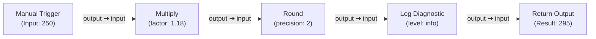
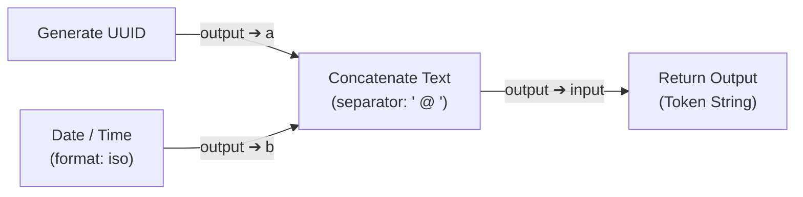
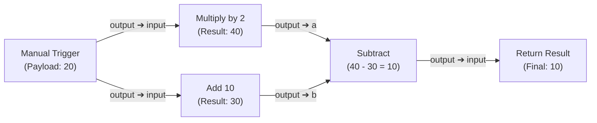

# Dormammu Engine — Node Reference & Workflow Creation Guide

A comprehensive, authoritative manual detailing the architecture, every input/output port of all 20 nodes, configuration schemas, and the standard operating procedure for designing, validating, and executing production-grade Directed Acyclic Graph (DAG) workflows.

---

## Table of Contents
1. [Core Concepts: What is a Dormammu Workflow?](#1-core-concepts-what-is-a-dormammu-workflow)
2. [Step-by-Step: How to Design a Proper Process](#2-step-by-step-how-to-design-a-proper-process)
3. [Workflow Lifecycle & Execution Mechanics](#3-workflow-lifecycle--execution-mechanics)
4. [Complete 20-Node Specification Reference](#4-complete-20-node-specification-reference)
   - [Triggers & Input Nodes](#41-triggers--input-nodes)
     - [`trigger.manual`](#triggermanual---manual-trigger)
     - [`data.input`](#datainput---input--set-value)
   - [Mathematical Processing Nodes](#42-mathematical-processing-nodes)
     - [`math.add`](#mathadd---addition)
     - [`math.subtract`](#mathsubtract---subtraction)
     - [`math.multiply`](#mathmultiply---multiplication)
     - [`math.divide`](#mathdivide---division)
     - [`math.modulo`](#mathmodulo---modulo--remainder)
     - [`math.power`](#mathpower---exponentiation)
     - [`math.round`](#mathround---rounding)
     - [`math.abs`](#mathabs---absolute-value)
     - [`math.min`](#mathmin---minimum)
     - [`math.max`](#mathmax---maximum)
     - [`math.average`](#mathaverage---average--mean)
   - [JSON & Data Processing Nodes](#43-json--data-processing-nodes)
     - [`json.parse`](#jsonparse---parse-json-string)
     - [`json.get`](#jsonget---extract-nested-json-field)
   - [Text & String Nodes](#44-text--string-nodes)
     - [`text.concat`](#textconcat---concatenate-strings)
   - [Utility Nodes](#45-utility-nodes)
     - [`utility.uuid`](#utilityuuid---generate-v4-uuid)
     - [`utility.datetime`](#utilitydatetime---timestamp--iso-datetime)
   - [Output & Logging Nodes](#46-output--logging-nodes)
     - [`output.log`](#outputlog---diagnostic-logger)
     - [`output.return`](#outputreturn---workflow-final-output)
5. [Best Practices & Validation Rules](#5-best-practices--validation-rules)
6. [Real-World Pipeline Blueprints](#6-real-world-pipeline-blueprints)

---

## 1. Core Concepts: What is a Dormammu Workflow?

A workflow in Dormammu Engine is a **Directed Acyclic Graph (DAG)**.
- **Nodes** represent atomic, isolated operations (fetching input, arithmetic, parsing JSON, string manipulation, logging, or returning a result).
- **Edges** represent directed data channels connecting an **output port** of an upstream node to an **input port** of a downstream node.
- **DAG Rule**: Data flows in strictly one direction (from upstream triggers to downstream outputs). There are **no recursive loops or cycles**.

```
[Trigger / Input] ──► [Transformation / Logic] ──► [Output / Return]
```

### Why a Directed Acyclic Graph (DAG)?
1. **Deterministic Execution**: Every node executes only after all its dependencies (upstream nodes) have succeeded.
2. **Infinite Loop Immunity**: The engine's multi-level validator uses a 3-color DFS cycle detector to mathematically reject any graph containing loops.
3. **Parallel Branching & Convergence**: Multiple independent branches can execute in parallel and converge into downstream joining nodes.

---

## 2. Step-by-Step: How to Design a Proper Process

To create a clean, maintainable, and reliable workflow, follow this 5-stage blueprint:

### Stage 1: Establish the Entry Point
Every executable workflow must have at least one entry node (in-degree = 0):
- Use **`trigger.manual`** if your workflow is initiated manually or via an API call containing a JSON payload or numeric value.
- Use **`data.input`** if you want to extract specific fields directly from the global trigger payload with fallback defaults.
- Use **`utility.uuid`** or **`utility.datetime`** if your workflow generates identifiers or logs events periodically.

### Stage 2: Transform & Cleanse Data
Process the raw data ingested by the entry point:
- If receiving JSON strings (e.g. from an API request), pipe the payload into **`json.parse`**.
- Extract target properties with **`json.get`** using dot paths (e.g. `order.total` or `user.preferences.theme`).

### Stage 3: Apply Computational Logic
Wire outputs into mathematical or text manipulation nodes:
- Perform calculations using **`math.add`**, **`math.multiply`**, **`math.round`**, etc.
- You can supply values in two ways:
  1. **Dynamic Connection**: Wire another node's output into port `b`.
  2. **Static Config**: Leave port `b` disconnected and specify a fallback in the Node Inspector (e.g. `factor: 1.18` for tax calculation).

### Stage 4: Log Diagnostic Checkpoints (Optional)
Insert **`output.log`** nodes at critical intersections. `output.log` records data to the execution audit log and immediately forwards the input value unaltered to downstream nodes, allowing non-disruptive debugging.

### Stage 5: Terminate with a Final Output
Every workflow that computes a result should end with **`output.return`**:
- Connect the terminal computation output to `output.return`'s `input` port.
- When the execution finishes, the value received by `output.return` is extracted as the workflow run's `finalOutput`.

---

## 3. Workflow Lifecycle & Execution Mechanics

```
┌─────────────────┐       ┌─────────────────┐       ┌─────────────────┐
│ Visual Builder  │ ────► │ Multi-Level     │ ────► │ PostgreSQL DB   │
│ & Canvas UI     │       │ Graph Validator │       │ (Immutable vN)  │
└─────────────────┘       └─────────────────┘       └─────────────────┘
                                                             │
                                                             ▼
┌─────────────────┐       ┌─────────────────┐       ┌─────────────────┐
│ Execution Modal │ ◄──── │ Sequential DAG  │ ◄──── │ Planner         │
│ Task Statuses   │       │ Scheduler       │       │ O(V + E) Sort   │
└─────────────────┘       └─────────────────┘       └─────────────────┘
```

1. **Composition**: The visual frontend builds a standard JSON schema containing `nodes` and `edges`.
2. **Validation**: The engine validates:
   - **Level 1 (Structural)**: Required node keys, IDs, position numbers.
   - **Level 2 (Graph Integrity)**: Unknown node types, port existence, self-loops, and cycles ($A \to B \to A$).
   - **Level 3 (Configuration)**: Valid numbers, non-zero divisors, proper JSON strings.
   - **Level 4 (Semantic)**: Port data types and connectivity.
3. **Immutable Versioning**: Saving creates a new immutable version ($v1 \to v2 \to v3$) in PostgreSQL. Prior versions are never mutated.
4. **Execution**:
   - The **Planner** builds adjacency matrices and calculates in-degrees.
   - The **Scheduler** visits nodes topologically.
   - If a node fails, the scheduler triggers **fail-fast cascading**: all downstream dependent nodes are marked `BLOCKED`, and the run status is marked `FAILED`.

---

## 4. Complete 20-Node Specification Reference

### Port Architecture Principles & Rationale
To eliminate clutter, visual ambiguity, and connection errors, every node in Dormammu follows a strict, well-reasoned port contract:
1. **Single Canonical Output (`output`)**: Every operation yields its result through exactly one standard output port: `output` (with the single exception of `utility.datetime` which also provides `timestamp` for epoch milliseconds).
2. **Predictable Input Contracts**:
   - **Roots / Triggers** (`trigger.manual`, `data.input`, `utility.uuid`, `utility.datetime`): `0` input ports (`inputs: {}`).
   - **Unary Transforms** (`math.round`, `math.abs`, `json.parse`, `output.log`, `output.return`): `1` input port (`input`).
   - **Binary Arithmetic & Operations** (`math.add`, `math.subtract`, `math.multiply`, `math.divide`, `math.modulo`, `math.min`, `math.max`, `math.average`, `text.concat`): `2` input ports (`a`, `b`).
   - **Powers / Exponentiation** (`math.power`): `2` input ports (`base`, `exponent`).
   - **Object Query** (`json.get`): `2` input ports (`input`, `path`).
3. **Seamless Backwards Compatibility**: Legacy workflows referencing old port names (`result` for `output`, `input` for `a`/`base`) are automatically normalized by the engine validator and runtime.

---

### 4.1 Triggers & Input Nodes

#### `trigger.manual` — Manual Trigger
Workflow root trigger that initiates execution when a user clicks Run in the UI or invokes the execution API.

| Port / Config | Name | Type | Description |
|:---|:---|:---|:---|
| **Input Ports** | *None* | — | Entry point node; has 0 incoming ports. |
| **Output Port** | `output` | `any` | Emits the trigger payload (or `defaultPayload`) to downstream nodes. |
| **Configuration** | `triggerKey` | `string` | Optional unique targeting key when multiple manual triggers are present (e.g. `'orderData'`, `'userData'`). |
| **Configuration** | `defaultPayload` | `json` | Default fallback payload (object or primitive) used when running without trigger input. |

##### Handling Workflows with Multiple Manual Triggers
When a workflow contains **two or more manual triggers**, Dormammu handles them deterministically:
1. **Parallel Entry Points**: All manual triggers act as valid DAG roots and start simultaneously in the execution ready queue.
2. **Targeted Per-Trigger Ingestion**:
   - The execution modal allows configuring separate inputs for each trigger.
   - The backend resolves payloads targeted by `node.id`, `node.config.triggerKey`, or `node.name`.
   - Packaged multi-trigger payloads use `{ "$multiTrigger": true, "<nodeId>": payload, ... }`.
3. **Broadcast Mode**: Users can toggle to "Broadcast" in the UI to send an identical shared payload to all manual triggers.
4. **Independent Fallbacks**: Any trigger that does not receive an explicit input cleanly falls back to its own configured `defaultPayload` without blocking the workflow.

---

#### `data.input` — Input / Set Value
Extracts a specific property from the execution trigger payload or provides a hardcoded static value.

| Port / Config | Name | Type | Description |
|:---|:---|:---|:---|
| **Input Ports** | *None* | — | Entry point node; has 0 incoming ports. |
| **Output Port** | `output` | `any` | Extracted value from trigger payload or default value. |
| **Configuration** | `key` | `string` | Property key to extract from `triggerData` (leave blank to pass entire payload). |
| **Configuration** | `defaultValue`| `any` | Fallback value if `key` is missing in `triggerData`. |

---

### 4.2 Mathematical Processing Nodes

All binary mathematical nodes accept two dynamic inputs (`a` and `b`) or one dynamic input with a configured fallback constant.

#### `math.add` — Addition
Calculates the sum of two numbers: $\text{output} = a + b$.

| Port / Config | Name | Type | Description |
|:---|:---|:---|:---|
| **Input Port** | `a` | `number` | First summand. |
| **Input Port** | `b` | `number` | Second summand. |
| **Output Port** | `output` | `number` | Computed sum ($a + b$). |
| **Configuration** | `addend` | `number` | Fallback added to `a` if port `b` is disconnected (default: `0`). |

---

#### `math.subtract` — Subtraction
Calculates the difference between two numbers: $\text{output} = a - b$.

| Port / Config | Name | Type | Description |
|:---|:---|:---|:---|
| **Input Port** | `a` | `number` | Minuend. |
| **Input Port** | `b` | `number` | Subtrahend (number to subtract). |
| **Output Port** | `output` | `number` | Computed difference ($a - b$). |
| **Configuration** | `subtrahend` | `number` | Fallback subtracted from `a` if port `b` is disconnected (default: `0`). |

---

#### `math.multiply` — Multiplication
Calculates the product of two numbers: $\text{output} = a \times b$.

| Port / Config | Name | Type | Description |
|:---|:---|:---|:---|
| **Input Port** | `a` | `number` | Multiplicand. |
| **Input Port** | `b` | `number` | Multiplier. |
| **Output Port** | `output` | `number` | Computed product ($a \times b$). |
| **Configuration** | `factor` | `number` | Fallback multiplier if port `b` is disconnected (default: `1`). |

---

#### `math.divide` — Division
Calculates the quotient: $\text{output} = a / b$.

| Port / Config | Name | Type | Description |
|:---|:---|:---|:---|
| **Input Port** | `a` | `number` | Dividend. |
| **Input Port** | `b` | `number` | Divisor. |
| **Output Port** | `output` | `number` | Computed quotient ($a / b$). |
| **Configuration** | `divisor` | `number` | Fallback divisor if port `b` is disconnected (default: `1`). |

> [!CAUTION]
> **Division by Zero Protection**: If $b = 0$, the node safely rejects execution with code `DIVISION_BY_ZERO`, failing the task gracefully instead of yielding `Infinity` or crashing the engine.

---

#### `math.modulo` — Modulo / Remainder
Calculates the integer remainder of division: $\text{output} = a \pmod b$.

| Port / Config | Name | Type | Description |
|:---|:---|:---|:---|
| **Input Port** | `a` | `number` | Dividend. |
| **Input Port** | `b` | `number` | Divisor. |
| **Output Port** | `output` | `number` | Remainder of $a / b$. |
| **Configuration** | `divisor` | `number` | Fallback divisor if port `b` is disconnected (default: `1`). |

---

#### `math.power` — Exponentiation
Calculates base raised to exponent: $\text{output} = \text{base}^{\text{exponent}}$.

| Port / Config | Name | Type | Description |
|:---|:---|:---|:---|
| **Input Port** | `base` | `number` | Base number. |
| **Input Port** | `exponent` | `number` | Exponent power. |
| **Output Port** | `output` | `number` | Computed power ($\text{base}^{\text{exponent}}$). |
| **Configuration** | `exponent` | `number` | Fallback exponent if port `exponent` is disconnected (default: `2`). |

---

#### `math.round` — Rounding
Rounds numbers using configurable algorithms and precision.

| Port / Config | Name | Type | Description |
|:---|:---|:---|:---|
| **Input Port** | `input` | `number` | Number to round. |
| **Output Port** | `output` | `number` | Rounded result. |
| **Configuration** | `precision` | `number` | Number of decimal places to keep (default: `0`). |
| **Configuration** | `mode` | `select` | Rounding algorithm: `"round"` (standard), `"floor"` (down), or `"ceil"` (up). |

---

#### `math.abs` — Absolute Value
Computes the magnitude of a number: $\text{output} = |x|$.

| Port / Config | Name | Type | Description |
|:---|:---|:---|:---|
| **Input Port** | `input` | `number` | Number to evaluate. |
| **Output Port** | `output` | `number` | Absolute value ($|x|$). |
| **Configuration** | *None* | — | Pure mathematical function; no config required. |

---

#### `math.min` — Minimum
Evaluates the smaller of two numbers: $\text{output} = \min(a, b)$.

| Port / Config | Name | Type | Description |
|:---|:---|:---|:---|
| **Input Port** | `a` | `number` | First number. |
| **Input Port** | `b` | `number` | Second number to compare. |
| **Output Port** | `output` | `number` | Smaller value of $a$ and $b$. |
| **Configuration** | `compareValue`| `number` | Fallback value for $b$ if port `b` is disconnected (default: `0`). |

---

#### `math.max` — Maximum
Evaluates the larger of two numbers: $\text{output} = \max(a, b)$.

| Port / Config | Name | Type | Description |
|:---|:---|:---|:---|
| **Input Port** | `a` | `number` | First number. |
| **Input Port** | `b` | `number` | Second number to compare. |
| **Output Port** | `output` | `number` | Larger value of $a$ and $b$. |
| **Configuration** | `compareValue`| `number` | Fallback value for $b$ if port `b` is disconnected (default: `0`). |

---

#### `math.average` — Average / Mean
Calculates the arithmetic mean: $\text{output} = \frac{a + b}{2}$.

| Port / Config | Name | Type | Description |
|:---|:---|:---|:---|
| **Input Port** | `a` | `number` | First value. |
| **Input Port** | `b` | `number` | Second value. |
| **Output Port** | `output` | `number` | Calculated average. |
| **Configuration** | *None* | — | Calculates dynamic average based on provided ports. |

---

### 4.3 JSON & Data Processing Nodes

#### `json.parse` — Parse JSON String
Converts a raw JSON string into a structured JavaScript object or array.

| Port / Config | Name | Type | Description |
|:---|:---|:---|:---|
| **Input Port** | `input` | `string` | Raw JSON string to parse. |
| **Output Port** | `output` | `any` | Parsed object/array data. |
| **Configuration** | `defaultText` | `string` | Default fallback JSON string if input port is disconnected (default: `"{}"`). |

> [!NOTE]
> If invalid JSON syntax is supplied, the node throws a structured `INVALID_JSON` error explaining the syntax fault without crashing the engine.

---

#### `json.get` — Extract Nested JSON Field
Extracts a specific property from an object using dot notation or bracket notation (e.g. `user.profile.emails[0]`).

| Port / Config | Name | Type | Description |
|:---|:---|:---|:---|
| **Input Port** | `input` | `any` | Target object or array. |
| **Input Port** | `path` | `string` | Dynamic extraction path (e.g. `"items[2].id"`). |
| **Output Port** | `output` | `any` | Extracted value. |
| **Configuration** | `path` | `string` | Static dot notation path to extract (e.g. `"user.score"`). |
| **Configuration** | `defaultValue`| `any` | Fallback value returned if the path does not exist (default: `null`). |

---

### 4.4 Text & String Nodes

#### `text.concat` — Concatenate Strings
Combines two text strings together with an optional separator and suffix.

| Port / Config | Name | Type | Description |
|:---|:---|:---|:---|
| **Input Port** | `a` | `string` | First string. |
| **Input Port** | `b` | `string` | Second string. |
| **Output Port** | `output` | `string` | Combined string result. |
| **Configuration** | `separator` | `string` | Delimiter inserted between values (e.g. `" "`, `", "`, or `""`). |
| **Configuration** | `suffix` | `string` | Optional text appended to the very end of the result. |

---

### 4.5 Utility Nodes

#### `utility.uuid` — Generate v4 UUID
Generates a random, universally unique identifier compliant with RFC 4122 v4.

| Port / Config | Name | Type | Description |
|:---|:---|:---|:---|
| **Input Ports** | *None* | — | Entry point node; has 0 incoming ports. |
| **Output Port** | `output` | `string` | Formatted UUID (e.g. `c73bcdcc-2669-4bf6-81d3-e4ae73fb11fd`). |
| **Configuration** | *None* | — | Generates fresh UUID on each task run. |

---

#### `utility.datetime` — Timestamp & ISO Datetime
Outputs the current timestamp formatted according to the configured standard.

| Port / Config | Name | Type | Description |
|:---|:---|:---|:---|
| **Input Ports** | *None* | — | Entry point node; has 0 incoming ports. |
| **Output Port** | `output` | `string` | Formatted date string (ISO or UTC). |
| **Output Port** | `timestamp`| `number` | Current UNIX epoch timestamp in milliseconds. |
| **Configuration** | `format` | `select` | Output format: `"iso"` (default), `"utc"`, `"epoch_ms"`, or `"epoch_s"`. |

---

### 4.6 Output & Logging Nodes

#### `output.log` — Diagnostic Logger
Logs data to the execution audit record at the specified severity level while passing data through seamlessly to downstream nodes.

| Port / Config | Name | Type | Description |
|:---|:---|:---|:---|
| **Input Port** | `input` | `any` | Data or message to log. |
| **Output Port** | `output` | `any` | Forwards the identical incoming input value downstream. |
| **Configuration** | `level` | `select` | Severity level: `"info"` (default), `"warn"`, `"error"`, or `"debug"`. |

---

#### `output.return` — Workflow Final Output
Designates the definitive output value of the entire workflow.

| Port / Config | Name | Type | Description |
|:---|:---|:---|:---|
| **Input Port** | `input` | `any` | Value to declare as the workflow's return result. |
| **Output Port** | `output` | `any` | Forwards final value. |
| **Configuration** | *None* | — | Captures whatever is supplied to its input port. |

---

## 5. Best Practices & Validation Rules

To ensure your workflows run reliably without validation errors:

1. **Avoid Cycles (Circular Dependencies)**
   - Wires must strictly flow forward.
   - Example of an invalid cycle: Node $A \to$ Node $B \to$ Node $A$.
   - The engine will flag any cycle in red and highlight the cycle path in the validation flyout.

2. **Understand Single-Input vs. Multi-Input Ports**
   - Most ports (`input`, `a`, `b`) are single-input ports. Connecting a new wire to a single-input port replaces the old wire automatically.
   - Do not attempt to force multiple connections into a non-array port.

3. **Provide Config Fallbacks**
   - If an input port (like `b` on `math.multiply`) is left unwired, ensure the node's configuration has a valid default (e.g. `factor: 2`).

4. **Use Auto-Layout (`Tidy`) for Clarity**
   - Press `T` or click the `Tidy` wand tool to automatically arrange nodes into hierarchical columns from left to right.

5. **Test With Preset Payloads**
   - Click `Run` in the top header. Test with both numeric inputs (`25`) and structured JSON (`{"user": "Alice", "score": 100}`) to confirm your pipeline handles different payloads properly.

---

## 6. Real-World Pipeline Blueprints

### Blueprint A: E-Commerce Tax & Total Calculation
*Ingests a subtotal, applies 18% GST/VAT, and outputs the rounded grand total.*



1. **`trigger.manual`** (`trigger_01`): Starts with payload `250`.
2. **`math.multiply`** (`math_01`): Configured with `factor: 1.18`. Calculates $250 \times 1.18 = 295.00$.
3. **`math.round`** (`round_01`): Keeps 2 decimal places.
4. **`output.log`** (`log_01`): Writes `"295"` to audit log.
5. **`output.return`** (`return_01`): Returns `295` to the caller.

---

### Blueprint B: User Authentication Token Generator
*Generates an ISO timestamp and UUID, merges them into a session token, and returns it.*



1. **`utility.uuid`** (`uuid_01`): Emits `9b1deb4d-3b7d-4bad-9bdd-2b0d7b3dcb6d`.
2. **`utility.datetime`** (`dt_01`): Emits `2026-10-25T18:00:00.000Z`.
3. **`text.concat`** (`concat_01`): Configured with `separator: " @ "`. Produces `9b1deb4d... @ 2026-10-25...`.
4. **`output.return`** (`return_01`): Emits the final formatted authentication token.

---

### Blueprint C: Branching & Joining Math DAG
*Takes a base number, branches into parallel add and multiply operations, and converges into a subtraction.*



1. **`trigger.manual`**: Broadcasts `20` to both `Add` and `Multiply`.
2. **`math.add`**: Computes $20 + 10 = 30$.
3. **`math.multiply`**: Computes $20 \times 2 = 40$.
4. **`math.subtract`**: Receives `40` on port `a` and `30` on port `b`. Computes $40 - 30 = 10$.
5. **`output.return`**: Emits `10`.
