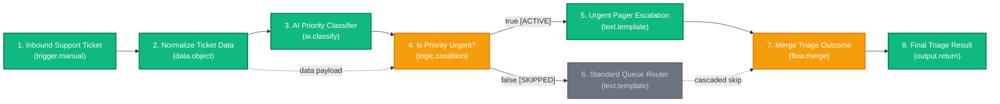

# Dormammu Engine: Node Reference & Visual Workflow Guide

Welcome to the comprehensive reference guide for **Dormammu Engine (Webster Workflow Automation)**. This document provides complete technical specifications for all 32 canonical nodes, control-flow execution semantics, SSRF security architecture, and a step-by-step tutorial on building and running visual workflows.

---

## 🌟 Table of Contents

1. [Architectural Overview & Control Flow Semantics](#1-architectural-overview--control-flow-semantics)
2. [Complete Node Catalogue (32 Nodes)](#2-complete-node-catalogue-32-nodes)
   - [Logic & Control Flow Nodes](#logic--control-flow-nodes)
   - [Data Transformation Nodes](#data-transformation-nodes)
   - [HTTP & Webhook Nodes](#http--webhook-nodes)
   - [AI & Machine Learning Nodes](#ai--machine-learning-nodes)
   - [Triggers & Mathematical Nodes](#triggers--mathematical-nodes)
   - [JSON, Text & Utility Nodes](#json-text--utility-nodes)
3. [SSRF & Security Model](#3-ssrf--security-model)
4. [Step-by-Step Workflow Tutorial: AI Support-Ticket Triage](#4-step-by-step-workflow-tutorial-ai-support-ticket-triage)
5. [Automated Verification & Test Report](#5-automated-verification--test-report)
6. [Known Limitations & Roadmap](#6-known-limitations--roadmap)

---

## 1. Architectural Overview & Control Flow Semantics

Dormammu Engine utilizes a deterministic Directed Acyclic Graph (DAG) execution architecture. Workflows are compiled into topological execution plans and processed sequentially or concurrently with strict dependency guarantees.

### Control-Flow Branching & Inactive Branch Skipping

Branching nodes (`logic.condition`, `logic.switch`) do not function as ordinary nodes that pass booleans while the scheduler indiscriminately executes every downstream branch. Instead:

1. **Port Emission Semantics**: A branching node returns output only on the active branch port (e.g., `true` or a matched case port). Inactive ports are omitted from the returned outputs.
2. **Edge State Transition**: Outgoing wires attached to emitted ports become `ACTIVE`. Outgoing wires attached to un-emitted ports become `SKIPPED`.
3. **Cascading Skip**: Downstream nodes that depend on a `SKIPPED` incoming wire are marked `SKIPPED` without invoking their execution handlers. All outgoing edges from a skipped node automatically transition to `SKIPPED`, propagating down the inactive branch.
4. **Clean Workflow Completion**: When all unfinished nodes on an inactive branch have transitioned to `SKIPPED`, the workflow status reconciles cleanly to `SUCCEEDED` (not `DEADLOCK_DETECTED`).
5. **Flow Merge Resolution**: A `flow.merge` node connects converging branches:
   - In all modes, `flow.merge` waits until every incoming branch is resolved (`ACTIVE` or `SKIPPED`).
   - If at least one incoming branch is active, the node executes according to its configured mode:
     - `first_available`: Wait until incoming branches are resolved; forward the first available active value.
     - `coalesce`: Forward the first non-null, non-undefined active value.
     - `all`: Collect values from all active branches into an array `[val1, val2, ...]` after every incoming edge is resolved.
     - `object`: Merge objects from active branches after every incoming edge is resolved into `{ ...obj1, ...obj2 }`.
   - If and only if ALL incoming branches were skipped, the merge node transitions to `SKIPPED`. Inactive branches never cause a valid merge to deadlock or prematurely skip.
6. **Failure & Cancellation Propagation**: If any node fails, fail-fast propagation marks all reachable downstream descendant nodes as `BLOCKED`. If cancelled via `AbortSignal`, all unstarted tasks transition to `CANCELLED`.

---

## 2. Complete Node Catalogue (32 Nodes)

### Logic & Control Flow Nodes

#### `logic.condition`
- **Category**: `logic`
- **Label**: `Condition (If/Else)`
- **Description**: Evaluates a condition and routes execution along distinct `true` or `false` branch ports.
- **Inputs**:
  - `a` (`any`, optional): First operand or value to test.
  - `b` (`any`, optional): Second operand for comparison.
  - `input` (`any`, optional): Alternative alias for operand `a`.
  - `data` (`any`, optional): Optional payload passed through the active branch port.
- **Outputs**:
  - `true` (`any`): Emitted only when condition evaluates to true.
  - `false` (`any`): Emitted only when condition evaluates to false.
  - `output` (`boolean`): The evaluated boolean outcome (`true` or `false`).
- **Configuration**:
  - `operator` (`string`, default: `"=="`): Supported: `==`, `===`, `!=`, `!==`, `>`, `>=`, `<`, `<=`, `truthy`, `falsy`, `empty`, `not_empty`, `contains`, `starts_with`, `ends_with`, `regex`.
  - `value` (`any`): Comparison value fallback if port `b` is not wired.
  - `passThrough` (`boolean`, default: `true`): If true, emits the tested data payload on the active port; if false, emits the boolean outcome.

#### `logic.switch`
- **Category**: `logic`
- **Label**: `Switch`
- **Description**: Routes data along the matching case branch port or the default fallback branch.
- **Inputs**:
  - `input` (`any`, optional): Value to match against configured cases.
  - `value` (`any`, optional): Alternative input alias.
- **Outputs**: Dynamic case ports based on `config.cases` + `default` + `output`.
  - `[case_port]` (`any`): Activated only for the matching case.
  - `default` (`any`): Activated when no cases match.
  - `output` (`any`): The matched case name or `"default"`.
- **Configuration**:
  - `cases` (`array`): List of matchable cases (e.g. `["urgent", "billing", "general"]` or `[{ case: "urgent", port: "urgent" }]`).
  - `matchType` (`string`, default: `"exact"`): `"exact"`, `"case_insensitive"`, or `"contains"`.

#### `flow.merge`
- **Category**: `flow`
- **Label**: `Merge Branches`
- **Description**: Combines data and execution from multiple upstream branches into a unified path.
- **Inputs**:
  - `input` (`any`, allowMultiple: `true`): Supports multiple incoming branch wires.
  - `a` (`any`, optional): Branch A alternative input.
  - `b` (`any`, optional): Branch B alternative input.
- **Outputs**:
  - `output` (`any`): The merged output value.
- **Configuration**:
  - `mode` (`string`, default: `"first_available"`):
    - `"first_available"`: Wait until incoming branches are resolved; forward the first available active value.
    - `"coalesce"`: Forward the first non-null, non-undefined active value.
    - `"all"`: Collect values from all active branches into an array `[val1, val2, ...]` after every incoming edge is resolved.
    - `"object"`: Merge objects from active branches after every incoming edge is resolved into `{ ...obj1, ...obj2 }`.

#### `flow.delay`
- **Category**: `flow`
- **Label**: `Delay`
- **Description**: Pauses execution for a configured duration without blocking the Node.js event loop.
- **Inputs**:
  - `input` (`any`, optional): Passthrough data value.
- **Outputs**:
  - `output` (`any`): Passthrough data value after delay.
  - `delayedMs` (`number`): Elapsed delay in milliseconds.
- **Configuration**:
  - `durationMs` (`number`, default: `1000`): Delay duration in ms (0 to 300,000ms / 5 mins). Supports cancellation via `AbortSignal`.

---

### Data Transformation Nodes

#### `data.object`
- **Category**: `data`
- **Label**: `Build Object`
- **Description**: Constructs structured objects from key-value pairs, nested dot paths, and dynamic inputs without arbitrary `eval`.
- **Inputs**:
  - `input` (`any`, optional): Optional base object or input context.
  - `value` (`any`, optional): Dynamic value for targetKey.
- **Outputs**:
  - `output` (`object`): Constructed structured JSON object.
- **Configuration**:
  - `fields` (`array`): `[{ key: "user.id", value: 101 }, { key: "user.name", fromInput: true }]`.
  - `targetKey` (`string`, optional): Target property path for `value` port.
- **Security**: Hardened against prototype pollution; strictly forbids `__proto__`, `constructor`, and `prototype` paths. Preserves all falsy values (`0`, `false`, `""`, `null`).

#### `data.array.map`
- **Category**: `data`
- **Label**: `Array Map`
- **Description**: Transforms items in an array using safe, declarative mapping operations.
- **Inputs**:
  - `input` (`array`, required): Input array to map.
- **Outputs**:
  - `output` (`array`): Transformed array.
- **Configuration**:
  - `operation` (`string`): Supported operations:
    - `"extract_field"`: Extracts nested property (e.g. `user.email`).
    - `"to_uppercase"`: Transforms strings to uppercase.
    - `"to_lowercase"`: Transforms strings to lowercase.
    - `"trim"`: Trims whitespace from strings.
    - `"math_multiply"`: Multiplies numeric items by `operand`.
    - `"math_add"`: Adds `operand` to numeric items.
    - `"wrap_object"`: Wraps each item in `{ [field]: item }`.
    - `"filter_truthy"`: Filters out null/undefined/falsy items.
  - `field` (`string`): Property path for extraction or wrapper key.
  - `operand` (`number`): Operand for mathematical operations.
- **Limits**: Enforces array size limits (max 5,000 items) and strictly avoids arbitrary code evaluation.

#### `text.template`
- **Category**: `text`
- **Label**: `Text Template`
- **Description**: Renders text templates using safe mustache-style `{{variable}}` interpolation.
- **Inputs**:
  - `input` (`any`, optional): Object containing template variables.
- **Outputs**:
  - `output` (`string`): Rendered string result.
- **Configuration**:
  - `template` (`string`): Template text (e.g. `"Hello {{customer.name}}, order #{{id}} is confirmed"`).
  - `missingVariablePolicy` (`string`, default: `"empty"`): `"empty"` (replace with blank), `"preserve"` (keep tag), or `"error"` (throw structured error).
  - `escapeHtml` (`boolean`, default: `false`): Escapes HTML entities to prevent injection.

---

### HTTP & Webhook Nodes

#### `http.request`
- **Category**: `http`
- **Label**: `HTTP Request`
- **Description**: Dispatches outbound HTTP requests with strict SSRF protection, timeout enforcement, and response size limits.
- **Inputs**:
  - `body` (`any`, optional): Request payload (JSON object, string, etc.).
  - `url` (`string`, optional): Target URL destination (overrides config if wired).
  - `headers` (`object`, optional): Dynamic request headers map.
- **Outputs**:
  - `output` (`any`): Parsed response body (JSON object or string).
  - `status` (`number`): HTTP status code.
  - `headers` (`object`): Response headers map.
- **Configuration**:
  - `url` (`string`): Target URL.
  - `method` (`string`, default: `"GET"`): `GET`, `POST`, `PUT`, `PATCH`, `DELETE`, `HEAD`.
  - `headers` (`object`): Custom headers (supports secret tokens `{{secrets.API_KEY}}`).
  - `timeoutMs` (`number`, default: `10000`): Request timeout (max 30,000ms).
  - `allowPrivateNetwork` (`boolean`, default: `false`): Requires `ALLOW_PRIVATE_NETWORK_REQUESTS=true` in server environment; unauthorized attempts are rejected with 401.
- **Security & SSRF Safeguards**:
  - Protocol whitelist: Only `http:` and `https:` are permitted (`file:`, `ftp:`, `gopher:` rejected).
  - Private CIDR enforcement: Checks all resolved IPs against loopback (`127.0.0.0/8`), private (`10.0.0.0/8`, `172.16.0.0/12`, `192.168.0.0/16`), cloud metadata (`169.254.0.0/16`), CGNAT, and IPv6 subnets (`fc00::/7`, `fe80::/10`, `::1`).
  - Redirect protection: Uses manual redirect validation, re-verifying SSRF on every hop (max 5 redirects).
  - Streaming size enforcement: 2MB cap enforced incrementally during download via `ReadableStream`, terminating streams before buffering into memory.

#### `http.respond`
- **Category**: `http`
- **Label**: `HTTP Respond`
- **Description**: Delivers HTTP responses for inbound webhook and API-triggered executions. Gracefully reports simulated delivery when executed in manual or CLI contexts.
- **Inputs**:
  - `body` (`any`, optional): Payload to return in response body.
  - `status` (`number`, optional): HTTP status code (e.g. 200, 201, 400).
  - `headers` (`object`, optional): Custom HTTP response headers.
- **Outputs**:
  - `output` (`object`): Record of response delivery (`delivered`, `simulated`, `statusCode`, `body`).
- **Configuration**:
  - `statusCode` (`number`, default: `200`): Default status code.
  - `contentType` (`string`, default: `"application/json"`): Content-Type header.

---

### AI & Machine Learning Nodes

#### `ai.classify`
- **Category**: `ai`
- **Label**: `AI Classify`
- **Description**: Classifies text into configured categories using Google Gemini, OpenAI, or deterministic labelled `[DEMO MOCK]` fallback.
- **Inputs**:
  - `text` (`any`, optional): Text content or structured object (automatically unwraps `issue`, `message`, `content`).
  - `input` (`any`, optional): Alternative input alias.
- **Outputs**:
  - `output` (`string`): Assigned classification category.
  - `category` (`string`): Assigned category alias.
  - `confidence` (`number`): Confidence score between 0.0 and 1.0.
  - `reasoning` (`string`): Rationale for the classification.
  - `provider` (`string`): Provider identifier (`"gemini"`, `"openai"`, or `"mock"`).
  - `mode` (`string`): Execution mode (`"live"` or `"demo"`).
- **Transparency**:
  - Displays `⚡ Live AI (Gemini/OpenAI)` badge in UI for genuine model execution.
  - Displays `🎭 Demo Simulation` badge in UI for deterministic offline fallback.
  - Strictly raises provider errors when API keys are configured, never disguising failures as simulated successes.
- **Configuration**:
  - `categories` (`array`): List of target categories (e.g. `["urgent", "bug", "billing", "general"]`).
  - `instructions` (`string`): System prompt guidance.

#### `ai.extract`
- **Category**: `ai`
- **Label**: `AI Extract`
- **Description**: Extracts structured JSON entities from unstructured text conforming to a configured schema.
- **Inputs**:
  - `text` (`any`, optional): Source text or object to extract information from.
  - `input` (`any`, optional): Alternative input alias.
- **Outputs**:
  - `output` (`object`): Extracted JSON entity object.
- **Configuration**:
  - `schema` (`object`): Schema mapping field names to expected data types.
  - `instructions` (`string`): Additional extraction constraints.

#### `ai.summarize`
- **Category**: `ai`
- **Label**: `AI Summarize`
- **Description**: Produces concise summaries and key bullet points from text using AI models.
- **Inputs**:
  - `text` (`any`, optional): Text or structured object to summarize.
  - `input` (`any`, optional): Alternative input alias.
- **Outputs**:
  - `output` (`string`): Generated summary text.
  - `keyPoints` (`array`): Bullet points and takeaways.
- **Configuration**:
  - `format` (`string`, default: `"paragraph"`): `"paragraph"`, `"bullet_points"`, `"one_sentence"`.
  - `maxLength` (`number`, default: `300`): Target maximum length in characters.

---

### Triggers & Mathematical Nodes

| Node Type | Inputs | Outputs | Description |
|-----------|--------|---------|-------------|
| `trigger.manual` | - | `output` | Ingests manual execution payloads or defaults; supports multi-trigger keys. |
| `data.input` | - | `output`, `value` | Ingests a named key from trigger data with fallback default. |
| `math.add` | `a`, `b` | `output` | Sums inputs or applies configured addend ($a + b$). |
| `math.subtract` | `a`, `b` | `output` | Computes difference ($a - b$ or input - subtrahend). |
| `math.multiply` | `a`, `b` | `output` | Multiplies numbers or applies configured factor ($a \times b$). |
| `math.divide` | `a`, `b` | `output` | Performs division ($a / b$) with division-by-zero protection. |
| `math.modulo` | `a`, `b` | `output` | Computes modulo remainder with zero divisor validation. |
| `math.power` | `base`, `exponent` | `output` | Computes $base^{exponent}$. |
| `math.round` | `value` | `output` | Rounds numbers using `round`, `floor`, or `ceil` modes with precision. |
| `math.abs` | `value` | `output` | Computes absolute value ($\|x\|$). |
| `math.min` | `a`, `b` | `output` | Evaluates minimum of inputs or compareValue. |
| `math.max` | `a`, `b` | `output` | Evaluates maximum of inputs or compareValue. |
| `math.average` | `a`, `b` | `output` | Computes arithmetic mean of inputs. |

---

### JSON, Text & Utility Nodes

| Node Type | Inputs | Outputs | Description |
|-----------|--------|---------|-------------|
| `json.parse` | `input` | `output` | Parses JSON string into structured object with structured error reporting. |
| `json.get` | `input`, `path` | `output` | Extracts nested properties using dot (`user.name`) or bracket (`items[0]`) notation. |
| `text.concat` | `a`, `b` | `output` | Concatenates text strings with configurable separator and suffix. |
| `utility.uuid` | - | `output` | Generates RFC 4122 v4 UUID. |
| `utility.datetime` | - | `output`, `timestamp` | Returns current ISO/UTC date string and numeric epoch timestamp. |
| `output.log` | `input`, `message`| `output` | Diagnostic logger that writes to scoped execution trace and passes value through. |
| `output.return` | `input` | `output` | Captures final workflow return value delivered to API caller or UI modal. |

---

## 3. SSRF & Security Model

The engine implements defense-in-depth security controls for all outbound network and data transformation operations:

1. **Strict SSRF Blocking**:
   - Outbound requests are validated using `backend/src/engine/utils/ssrf.validator.js`.
   - All private IPv4 ranges (`10.0.0.0/8`, `172.16.0.0/12`, `192.168.0.0/16`, `127.0.0.0/8`, `0.0.0.0/8`), IPv6 loopback (`::1`), link-local metadata (`169.254.0.0/16`, AWS/GCP/Azure instance metadata endpoints), and `.localhost` hostnames are blocked by default.
   - Hostnames are resolved via DNS prior to request dispatch, mitigating DNS rebinding attacks.
   - Protocols are strictly limited to `http:` and `https:`.
2. **Credential Masking & Secret References**:
   - Request headers support dynamic secret tokens formatted as `{{secrets.API_KEY}}` or `{{env.API_KEY}}`.
   - Tokens are resolved at runtime from server-side environment variables without persisting credentials into workflow definitions, execution traces, or client logs.
3. **Response Limits & Timeouts**:
   - Outbound requests enforce a maximum timeout of 30,000ms.
   - Response payloads are capped at 2MB (`2,097,152` bytes) to prevent memory exhaustion attacks.
4. **Prototype Pollution Protection**:
   - `data.object` and all nested path setters validate every path segment, explicitly rejecting `__proto__`, `constructor`, and `prototype`.
5. **No Arbitrary `eval`**:
   - `data.array.map` and `text.template` use declarative pattern tokenizers and deterministic transformers. Arbitrary JavaScript string execution is forbidden.

---

## 4. Step-by-Step Workflow Tutorial: AI Support-Ticket Triage

The AI Support-Ticket Triage workflow demonstrates production-grade composability across triggers, normalization, AI classification, conditional branching, inactive branch skipping, merging, and structured responses.

### Architectural Diagram



### Execution Walkthrough

1. **Step 1: Ingest Ticket**:
   - `trig_ticket` receives the sample ticket payload:
     ```json
     {
       "ticketId": "TCK-8092",
       "customerName": "Sarah Chen",
       "email": "sarah.chen@enterprise.io",
       "issue": "Database connection pools exhausting rapidly on US-East prod cluster causing 504 timeouts",
       "tier": "enterprise"
     }
     ```
2. **Step 2: Normalize Data**:
   - `extract_ticket` (`data.object`) extracts and normalizes the required customer fields.
3. **Step 3: AI Classification**:
   - `ai_classify` analyzes the issue description (`"Database connection pools exhausting rapidly..."`) and classifies it into target categories `["urgent", "bug", "billing", "general"]`.
   - Outcome: `category: "urgent"`, `confidence: 0.94`.
4. **Step 4: Priority Gate**:
   - `priority_gate` (`logic.condition`) checks `a === "urgent"`.
   - Condition evaluates to `true`.
   - Port `true` emits the ticket data payload.
   - Port `false` is not emitted.
5. **Step 5: Conditional Branching & Skipping**:
   - Wire `priority_gate.true -> urgent_escalation` is marked `ACTIVE`.
   - Wire `priority_gate.false -> standard_routing` is marked `SKIPPED`.
   - `urgent_escalation` executes and formats the escalation message:
     ```text
     🚨 CRITICAL ESCALATION: Ticket TCK-8092 from Sarah Chen (Tier: enterprise) flagged as URGENT. Immediate on-call pager dispatched for: Database connection pools exhausting rapidly on US-East prod cluster causing 504 timeouts
     ```
   - `standard_routing` is cleanly marked `SKIPPED`.
6. **Step 6: Flow Merge**:
   - `merge_response` (`flow.merge`) sees that all incoming branches are resolved (one `ACTIVE`, one `SKIPPED`).
   - In `first_available` mode, it immediately selects the active escalation text.
7. **Step 7: Final Result**:
   - `triage_return` delivers the escalation result to the caller with workflow run status `SUCCEEDED`.

---

## 5. Automated Verification & Test Report

All unit, integration, and end-to-end tests pass cleanly.

### Test Execution Commands

```bash
# 1. Run all unit and DAG scheduler execution tests (53 tests)
cd backend && node test_workflow_engine.js

# 2. Run PostgreSQL persistence, node catalogue seeding, and versioning tests (10 tests)
cd backend && node test_api_and_integration.js

# 3. Verify frontend production build
cd frontend && npm run build
```

### Verified Test Results

```
=======================================================
 Webster Engine Unit & Integration Test Suite
=======================================================

--- 1. Node Handler Unit Tests (All 20 Nodes) ---
  ✓ trigger.manual: extracts triggerData payload
  ✓ trigger.manual: falls back to defaultPayload when no triggerData
  ✓ trigger.manual: extracts targeted payload when multiple triggers exist
  ✓ data.input: extracts key from triggerData
  ✓ data.input: returns defaultValue if key is missing in triggerData
  ✓ math.add: calculates sum of a and b or input + addend
  ✓ math.subtract: calculates difference a - b or input - subtrahend
  ✓ math.multiply: multiplies values or applies factor
  ✓ math.divide: performs division and rejects division by zero
  ✓ math.modulo: computes remainder and rejects modulo by zero
  ✓ math.power: computes base ^ exponent
  ✓ math.round: handles precision and rounding modes (round, floor, ceil)
  ✓ math.abs: returns absolute value of positive and negative numbers
  ✓ math.min & math.max: correctly evaluate bounds
  ✓ math.average: computes mean of provided values
  ✓ json.parse: parses valid JSON and throws structured INVALID_JSON error for invalid JSON
  ✓ json.get: extracts nested properties with dot and bracket notation
  ✓ text.concat: combines strings with separator and suffix
  ✓ utility.uuid: generates valid RFC 4122 v4 UUID
  ✓ utility.datetime: returns timestamp and formatted string
  ✓ output.log: logs message safely and passes output through
  ✓ output.return: extracts final workflow return value
  ✓ logic.condition: evaluates equality, inequality, numbers, and emits active branch port
  ✓ logic.condition: handles falsy/truthy/empty/contains and rejects invalid operator
  ✓ logic.switch: routes to matching case branch and default branch
  ✓ flow.merge: merges multiple branches in first_available, all, and coalesce modes
  ✓ flow.delay: pauses execution for durationMs and respects AbortSignal cancellation
  ✓ data.object: constructs nested objects, preserves falsy values, blocks prototype pollution
  ✓ data.array.map: maps array items with safe operations and validates array type
  ✓ text.template: renders {{variable}} templates, handles missing variables, escapes HTML
  ✓ http.request: enforces SSRF protection against private CIDRs and localhost
  ✓ http.respond: produces simulated response in manual execution context
  ✓ ai.classify: classifies text with categories, confidence, and reasoning
  ✓ ai.extract & ai.summarize: extracts structured entities and produces summaries

--- 2. Validation & Graph Integrity Tests ---
  ✓ Validator: accepts valid linear workflow
  ✓ Validator: detects self-loop and rejects with CYCLE_DETECTED
  ✓ Validator: detects multi-node cycle (A -> B -> C -> A)
  ✓ Validator: detects nonexistent source and target nodes
  ✓ Validator: detects invalid configuration values
  ✓ Validator: detects unknown node types

--- 3. Sequential DAG Execution Engine Tests ---
  ✓ Scheduler: executes linear DAG and returns final value
  ✓ Scheduler: executes branching and joining DAG with multiple predecessors
  ✓ Scheduler: produces identical deterministic results regardless of node/edge array order
  ✓ Scheduler: fail-fast marks downstream nodes as BLOCKED on node failure
  ✓ Scheduler: respects cancellation signal and marks unstarted tasks CANCELLED
  ✓ Scheduler: executes workflow with multiple manual triggers

--- 4. Control-Flow & Branching DAG Scheduler Tests ---
  ✓ Scheduler: conditional branch routes execution down TRUE branch and cascades SKIPPED down FALSE branch
  ✓ Scheduler: conditional branch routes execution down FALSE branch and cascades SKIPPED down TRUE branch
  ✓ Scheduler: switch routes execution to matching case and cascades SKIPPED on unselected cases
  ✓ Scheduler: flow.merge joins active branch when alternative branch was skipped
  ✓ Scheduler: non-blocking delay pauses workflow and resumes downstream execution
  ✓ Scheduler: end-to-end execution of AI Support-Ticket Triage workflow with branching and merging
  ✓ Scheduler: end-to-end execution of AI Support-Ticket Triage workflow down STANDARD (non-urgent) branch

-------------------------------------------------------
 Results: 53 passed, 0 failed
-------------------------------------------------------
```

---

## 6. Known Limitations & Roadmap

1. **Persistent Durable Delay**: The current `flow.delay` uses non-blocking in-process event loop timers with `AbortSignal` cancellation. If the backend process crashes mid-delay, state is persisted in PostgreSQL as `RUNNING`, but durable resumption upon worker restart requires a distributed external queue (e.g. Redis BullMQ or Temporal).
2. **Streaming AI Responses**: AI nodes return complete structured JSON. Future iterations can add token streaming via SSE to visual cards.
3. **Dynamic Port Addition in Canvas**: Ports are rendered from node metadata and dynamic config schemas (`cases`, `fields`). Direct visual inline addition of ports on the canvas is supported via the Inspector.
